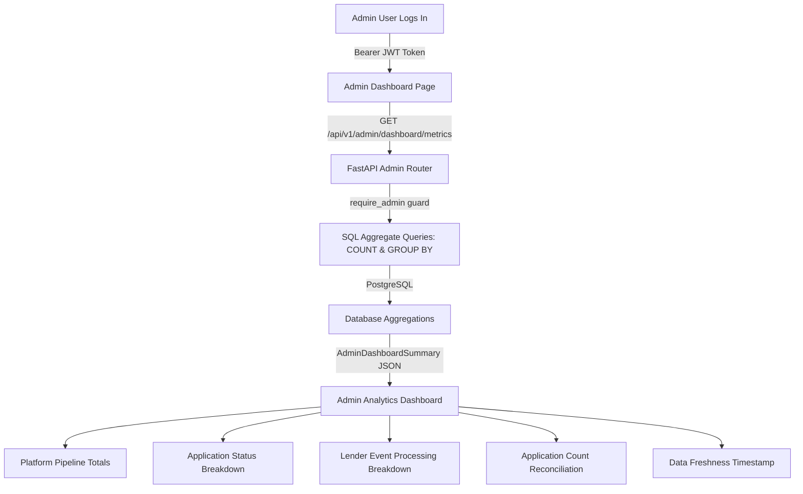

# Administrator Aggregate Analytics and Monitoring Dashboard

> **FICTIONAL DEMO / TRAINING DISCLAIMER**:
> This project is a fictional software training simulation. No actual credit checks, bureau requests, payment gateways, or real lender/banking institutions are integrated. All pipeline metrics, application statuses, mock events, and documents are local mocks for development and educational purposes.

---

## 1. Overview & Administrator Role Permissions

Step 13E completes the administrative monitoring interface in the Mini Loan Marketplace React application, providing a high-level, privacy-preserving aggregate telemetry view.

In the Mini Loan Marketplace architecture:
- **Admin Role (`admin`)**: Administrators monitor overall system health, pipeline velocity, funnel volume, and mock lender webhook processing states.
- **Strict Privacy & Zero PII Guardrail**: The administrator dashboard does not display customer names, email addresses, phone numbers, individual loan amounts, application IDs, or individual decision records.
- **Read-Only Scope**: The dashboard is strictly read-only; no policy editing, consent notice mutation, caller lead assignment, or status changes are executed from this view.



---

## 2. Existing Aggregate Metrics API Contract

- **Endpoint**: `GET /api/v1/admin/dashboard/metrics`
- **Router**: [`backend/app/api/v1/admin.py`](../backend/app/api/v1/admin.py)
- **Permissions**: Protected by `Depends(require_admin)`.
- **Identity Scoping**: Strictly derives identity from the authenticated JWT token. Never transmits `admin_id`, `customer_id`, or `caller_id` query or body parameters.
- **SQL Aggregations**: Executes native database `COUNT()` and `GROUP BY` operations; does not load rows into Python memory.

### Response Payload Structure (`AdminDashboardSummary`)

| Field | Type | Description |
| :--- | :--- | :--- |
| `total_leads` | `int` | `COUNT(Lead.id)` — Total prospective customer leads generated |
| `total_applications` | `int` | `COUNT(LoanApplication.id)` — Total loan applications initiated across all statuses |
| `total_match_runs` | `int` | `COUNT(MatchRun.id)` — Total multi-lender policy matching executions (all statuses) |
| `total_offers` | `int` | `COUNT(Offer.id)` — Total pre-qualified mock credit offers generated across all runs |
| `total_submissions` | `int` | `COUNT(OfferSubmission.id)` — Total offer submissions created (all statuses) |
| `applications_by_status` | `Dict[str, int]` | `GROUP BY LoanApplication.status` — Categorized distribution of applications |
| `lender_events_by_processing_status` | `Dict[str, int]` | `GROUP BY LenderEvent.processing_status` — Categorized distribution of webhook events |

---

## 3. Label Corrections & Semantics

In earlier prototype revisions, two platform metric labels were misleadingly named:

1. **"Total Match Runs"** (formerly labeled *"Completed Match Runs"*):
   - **Reason**: The backend executes `COUNT(MatchRun.id)`, counting all match run records in the database regardless of execution status (`completed`, `failed`, or `in_progress`).
   - **Correction**: Renamed to **Total Match Runs** to truthfully reflect the API query semantics.
2. **"Total Submissions"** (formerly labeled *"Dispatched Submissions"*):
   - **Reason**: The backend executes `COUNT(OfferSubmission.id)`, counting all submission records regardless of status (`submitted`, `accepted`, `declined`, `timed_out`, `failed`, `pending`).
   - **Correction**: Renamed to **Total Submissions** to accurately reflect total submission entities.

---

## 4. Breakdown Visualizations & Accessible Progress Indicators

To maintain a lean, dependency-free frontend architecture, all distributions are visualized using native semantic HTML and CSS without third-party charting libraries:

- **Component**: [`AggregateStatusBreakdown`](../frontend/src/features/admin/components/AggregateStatusBreakdown.tsx)
- **Features**:
  - **Deterministic Sorting**: Statuses are ordered descending by count, with a stable alphabetical tie-breaker on status label.
  - **Title Case Formatting**: Snake-case keys (e.g. `offer_selected`, `timed_out`) are cleanly formatted via [`formatAdminStatusLabel`](../frontend/src/features/admin/utils/adminMetrics.ts).
  - **Safe Percentages**: Share is calculated against the breakdown's own category sum (`(count / breakdownTotal) * 100`). If total count is zero, percentage safely defaults to `0.0%`, strictly preventing `NaN` or `Infinity`.
  - **Accessible Progress Indicators**: Native horizontal progress bars equipped with `role="progressbar"`, `aria-valuenow`, `aria-valuemin="0"`, `aria-valuemax="100"`, and screen-reader accessible labels.
  - **Zero-Count Support**: Displays statuses with zero counts clearly if returned by the backend.
  - **Extensible / Safe for Unknown Statuses**: Dynamically formats and renders any future or custom status returned by the backend without throwing.

---

## 5. Application Count Reconciliation Notice

Because `total_applications` and `applications_by_status` are evaluated via separate SQL aggregate expressions (`COUNT` vs `GROUP BY`), the frontend performs an automated consistency reconciliation:

- **Utility**: [`getApplicationCountConsistency`](../frontend/src/features/admin/utils/adminMetrics.ts)
- **Component**: [`AdminDataConsistencyNotice`](../frontend/src/features/admin/components/AdminDataConsistencyNotice.tsx)
- **States**:
  - **Reconciled (`isConsistent: true`)**: When $\sum(\text{applications\_by\_status}) = \text{total\_applications}$, displays a neutral success banner confirming platform data integrity.
  - **Discrepancy (`isConsistent: false`)**: If the sum differs from the reported total, displays an alert warning detailing the reported total, grouped total, and exact difference.
  - **Integrity Rule**: The application strictly never fabricates or silently adjusts numbers to force alignment.

---

## 6. Data Freshness & Error Resilience

- **On-Demand Retrieval**: The dashboard does not employ auto-polling timers or background intervals, preserving system resources.
- **Client Timestamp**: The "Last refreshed" indicator displays the browser retrieval time (`new Date().toLocaleTimeString()`), clearly disclaimed as client retrieval time rather than database mutation timestamp.
- **Preserved Snapshots on Refresh Failure**: If a manual refresh fails while viewing existing metrics, the application retains the current snapshot on screen, renders a warning alert explaining the failure, and provides a retry button without falsely updating the freshness timestamp.

---

## 7. Strict Privacy & Non-Goals

1. **Zero Customer PII**: Customer names, emails, phones, PANs, addresses, individual loan amounts, and individual application IDs are strictly omitted from all admin views.
2. **No Time-Series Fabrication**: The existing API returns current aggregate totals, not bucketed historical intervals. No simulated time trends, line charts, or fake daily trends are invented.
3. **No Policy or Consent Configuration**: Administrative lender policy editing and consent notice publishing are out of scope for this dashboard.
4. **No Database Migrations Required**: Reuses the existing `/api/v1/admin/dashboard/metrics` route and database models without alterations.

---

## 8. Verification & Automated Test Coverage

The administrative monitoring dashboard is backed by comprehensive automated test suites:

### Frontend Vitest Suite (141 tests passing across 20 test files)
- [`adminMetrics.test.ts`](../frontend/src/features/admin/utils/adminMetrics.test.ts): 13 pure utility tests verifying status sum calculation, empty/invalid input safety, descending sort with alphabetical tie-breakers, percentage calculation with zero denominators, Title Case status formatting, count reconciliation, and webhook event summary aggregation.
- [`AdminDashboard.test.tsx`](../frontend/src/features/admin/components/AdminDashboard.test.tsx): 10 component tests validating endpoint isolation, accurate metric card labels (`Total Match Runs`, `Total Submissions`), breakdown tables, progress bars, empty status maps, discrepancy warnings, refresh button behavior, snapshot preservation on refresh error, and absence of customer PII.
- [`Dashboards.test.tsx`](../frontend/src/pages/__tests__/Dashboards.test.tsx): Role-based dashboard tests verifying admin dashboard loading and security scoping.
- [`RouteGuards.test.tsx`](../frontend/src/app/__tests__/RouteGuards.test.tsx): Role guard tests verifying customers and callers are blocked from accessing `/admin/dashboard`.

### Backend Pytest Suite (311 tests passing)
- Unaltered backend test suite validates all 16 test modules including role-based access control, admin endpoint scoping, and aggregate metrics generation.

### Running Tests

```bash
# Frontend test suite
cd frontend
npm test -- --run

# Frontend typecheck & lint
npm run typecheck
npm run lint

# Backend test suite
cd backend
.venv/bin/python -m pytest -v
```
