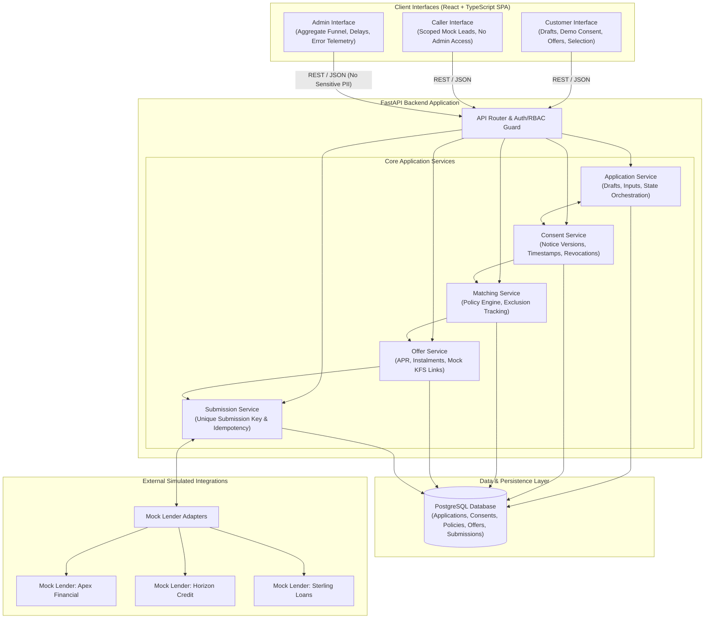

# Architecture Specification

## 1. Overview & System Purpose

The **Mini Loan Marketplace** is a full-stack training application built to demonstrate the clean architecture of a multi-lender credit platform in accordance with the Module 16 capstone requirements.

In this platform:
- Fictional borrowers initiate applications, provide purpose-specific demo consent, and evaluate mock loan offers.
- Callers view and manage mock leads strictly assigned to them with zero access to peer data or administrative controls.
- Administrators inspect aggregate funnel analytics, latency, and error metrics without receiving sensitive customer records.
- Simulated mock lenders (*Apex Financial*, *Horizon Credit*, *Sterling Loans*) evaluate applications against distinct policy rules without connecting to live financial networks or bureaus.

The platform is decoupled into a **React + TypeScript** frontend, a **FastAPI** backend, and a **PostgreSQL** relational database managed via **SQLAlchemy** and **Alembic**.

---

## 2. Architecture Diagram

---

## 3. Core Architectural Components

### 3.1. Client Interfaces
- **Customer Interface**: Supports application drafting, demographic input (age, monthly income, work type, requested amount), purpose-specific demo consent granting and revocation, eligible offers comparison (APR, amount, term, instalment, mock KFS link), and offer selection.
- **Caller Interface**: Scoped view granting access only to assigned mock leads; strictly prevents visibility of other callers' leads and blocks admin routes.
- **Admin Interface**: Provides aggregate business intelligence (application funnel stages, mock lender response latency, error events). Designed to never expose sensitive customer PII in telemetry payloads.

### 3.2. FastAPI Backend & Core Services
- **Application Service**: Manages draft applications, stores borrower input parameters (age, income, work type, amount), and validates lifecycle states.
- **Consent Service**: Records notice versions, timestamps, and explicit consent status (`GRANTED`, `REVOKED`). Allows revocation and verifies active consent prior to matching.
- **Matching Service**: Enforces active consent verification before executing three distinct mock lender underwriting policies. Persists policy versions, eligible matches, and exclusion reasons.
- **Offer Service**: Formats eligible offers with calculated APR, terms, monthly instalments, and mock KFS links. Displays nonmatching lender names transparently and manages offer selection.
- **Submission Service**: Enforces idempotency via unique submission keys, orchestrates mock lender adapter calls, processes simulated webhooks, and tracks final statuses.

### 3.3. Mock Lender Adapters (External Simulated Integrations)
- External to application user roles and core business models.
- Integrates three distinct mock lenders:
  - **Apex Financial Adapter**: Simulates prime tier risk appetite.
  - **Horizon Credit Adapter**: Simulates balanced risk appetite.
  - **Sterling Loans Adapter**: Simulates broad eligibility appetite.

### 3.4. Persistence Layer
- **PostgreSQL**: Relational storage for applications, audit trails (consent history, policy versions, exclusion reasons), offers, and submissions.
- **SQLAlchemy 2.0 & Alembic**: Declarative schemas, migrations, and transactional boundaries.

---

## 4. Failure Handling & Reliability Architecture

The backend services implement dedicated patterns to safely manage failure modes:

| Failure Scenario | Architectural Defense |
|---|---|
| **Success** | Atomic database transaction commits offer acceptance, generates partner tracking ID, and updates application state to `COMPLETED`. |
| **Decline** | Non-blocking exception logging; records exclusion reason code in the database and updates status to `DECLINED` without application failure. |
| **Timeout** | Asynchronous HTTP client timeouts (e.g., 2000 ms); circuit breakers fall back gracefully, recording telemetry in admin error events. |
| **Duplicate Webhook** | Idempotency guard backed by unique submission keys and webhook message IDs; duplicate payloads return `HTTP 200` without duplicate mutations. |
| **Late Webhook** | Monotonic state guard; webhooks arriving after terminal states (`TIMED_OUT`, `EXPIRED`, `CANCELLED`) are logged as audit events without mutating final state. |
| **Out-of-Order Status Event** | State transition validation matrix; rejects or buffers events that violate allowable lifecycle sequences (e.g. `DISBURSED` before `IN_REVIEW`). |

---

## 5. Scope & Design Guardrails

1. **Strictly Fictional**: All applicants, financial records, credit profiles, and lenders are mock simulations.
2. **Zero Real Integrations**: No live connections to credit bureaus, financial institutions, or SMS/OTP gateways.
3. **No Claim of Real Loan Approval**: The system simulates pre-qualification workflows; no actual credit or funds are extended.
4. **Capstone Scope Alignment**: Conforms strictly to Module 16 requirements without extraneous enterprise overhead.
