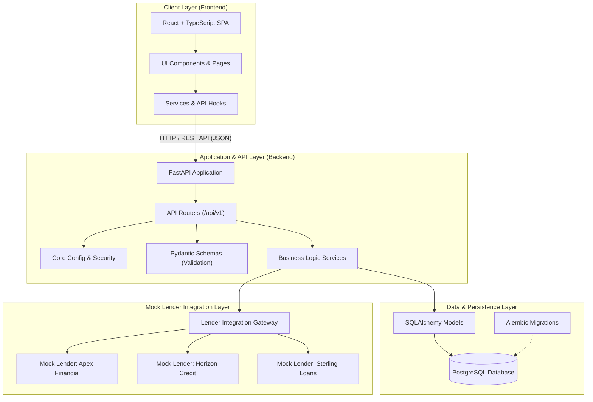

# Architecture Specification

## 1. Overview & System Purpose

The **Mini Loan Marketplace** is a full-stack training application designed to demonstrate the end-to-end architecture of a multi-lender consumer credit marketplace. In this platform:
- Borrowers submit fictional loan inquiries (e.g., loan amount, tenure, employment type).
- The platform evaluates applicant inputs against fictional underwriting rules.
- Fictional mock lenders (e.g., *Apex Financial*, *Horizon Credit*, *Sterling Loans*) evaluate the inquiry and generate competitive, personalized loan offers.
- Borrowers compare offers based on interest rate, tenure, and EMI, selecting the best fit.

The system is engineered following modern decoupled architecture practices: a high-performance **FastAPI** backend, a modern **React + TypeScript** frontend, and a relational **PostgreSQL** persistence layer managed via **SQLAlchemy** and **Alembic**.

---

## 2. Architecture Diagram

---

## 3. Core Architectural Layers

### 3.1. Client Layer (Frontend)
- **Framework**: React with TypeScript.
- **Role**: Provides a responsive, accessible interface for borrowers and administrators.
- **Key Modules**:
  - `src/components`: Reusable presentational UI elements (inputs, modals, badges, layout shells).
  - `src/pages`: Top-level route pages (Marketplace Landing, Application Form, Offers Dashboard, Admin Panel).
  - `src/features`: Domain-driven feature modules encapsulating feature-specific UI and business logic.
  - `src/services`: API client wrappers handling network requests to the backend.
  - `src/hooks`: Custom React hooks for state sharing, form management, and asynchronous data fetching.
  - `src/types`: TypeScript interfaces and types matching backend API schemas.

### 3.2. Application & API Layer (Backend)
- **Framework**: Python 3.11+ with FastAPI.
- **Role**: Serves RESTful endpoints, enforces input validation, orchestrates loan offer processing, and manages business workflows.
- **Key Modules**:
  - `app/api/v1`: Endpoint definitions and routing controllers.
  - `app/core`: Configuration settings (Pydantic BaseSettings), logging, and security utilities.
  - `app/schemas`: Pydantic data models for request validation and response serialization.
  - `app/services`: Application domain logic (loan eligibility checks, offer matching, application lifecycle).
  - `app/integrations/mock_lenders`: Simulators for external lending partners with configurable interest tiers and latency simulation.

### 3.3. Data & Persistence Layer
- **Database**: PostgreSQL.
- **ORM & Migrations**: SQLAlchemy (2.0 declarative style) and Alembic.
- **Key Modules**:
  - `app/db`: Database engine initialization, connection pooling, and session management.
  - `app/models`: SQLAlchemy entity declarations (Applications, Borrowers, Offers, Lenders).

### 3.4. Mock Integrations Layer
- **Role**: Replaces external third-party lenders, credit rating agencies, and notification gateways with completely isolated, deterministic mock adapters.
- **Characteristics**:
  - No network dependencies on external financial institutions.
  - Simulated underwriting criteria and response delays to emulate real-world asynchronous lender quoting.

---

## 4. Design Principles & Guidelines

1. **Separation of Concerns**: Strict layering between routing (`api`), validation (`schemas`), business logic (`services`), and persistence (`models`/`db`).
2. **Contract-Driven Communication**: TypeScript types mirror FastAPI Pydantic schemas to ensure end-to-end type safety.
3. **Fictional & Isolated by Design**: Zero connection to real credit bureaus, banking APIs, or external credentials.
4. **Testability**: Architecture decoupled to support unit, integration, and contract tests via Pytest, HTTPX, and Vitest.
5. **Container-Ready**: Designed for single-command orchestration with Docker.
