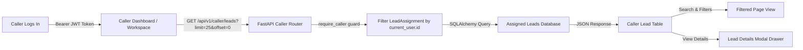

# Caller Assigned-Lead Workspace

> **FICTIONAL DEMO / TRAINING DISCLAIMER**:
> This project is a fictional software training simulation. No actual credit checks, bureau requests, payment gateways, or real lender/banking institutions are integrated. All lead records, synthetic references, caller assignments, and documents are local mocks for development and educational purposes.

---

## 1. Overview & Caller Role Permissions

Step 13D introduces a dedicated, accessible, and decimal-safe **Assigned-Lead Workspace** for callers in the React frontend.

In the Mini Loan Marketplace architecture:
- **Caller Role (`caller`)**: Callers assist prospective applicants by reviewing assigned lead records.
- **Strict Caller Isolation**: A caller can view **only** the leads explicitly assigned to their caller account. Access to another caller's leads is rejected with HTTP 403 / 404 at the database and service levels.
- **Privacy-Preserving Access**: Callers have zero access to administrative metrics, system configuration, lender policy editing, customer loan application modification, or customer consent records.



---

## 2. Backend Lead Retrieval API & Scoping

- **Endpoint**: `GET /api/v1/caller/leads?limit={limit}&offset={offset}`
- **Router**: [`backend/app/api/v1/caller.py`](../backend/app/api/v1/caller.py)
- **Permissions**: Protected by `Depends(require_caller)`.
- **Automatic Scoping**: The backend automatically derives `current_user.id` from the decoded JWT Bearer token in the `Authorization` header. The frontend strictly never passes `caller_id`, `customer_id`, or `role` query parameters or body payloads.
- **Ordering**: Enforces stable ordering by `Lead.id.asc()`.
- **Pagination**: Supports standard SQL `LIMIT` and `OFFSET`.

### API Response Structure (`CallerLeadResponse`)

| Field | Type | Description |
| :--- | :--- | :--- |
| `id` | `int` | Primary key of the lead entity |
| `synthetic_reference` | `str` | Public synthetic reference identifier (e.g. `SYN-LEAD-007`) |
| `applicant_name` | `str` | Full name of the applicant |
| `age` | `int` | Applicant age in years |
| `monthly_income` | `Decimal` (str) | Net monthly income in ₹ (returned as exact decimal string) |
| `work_type` | `str` | Employment category (`salaried`, `self_employed`, `other`) |
| `requested_amount` | `Decimal` (str) | Requested loan principal in ₹ |
| `status` | `str` | Current lead lifecycle status (e.g. `new`, `in_progress`) |
| `assigned_at` | `datetime` (str) | ISO-8601 timestamp when lead was assigned to the caller |

> **Privacy Guardrail**: Sensitive applicant information not provided by the backend (e.g. phone numbers, email addresses, residential addresses, credit reports, application IDs) is strictly absent from the API contract and frontend models.

---

## 3. Decimal-Safe Monetary Presentation

To ensure strict financial precision and eliminate floating-point calculation anomalies, all currency formatting reuses the zero-float utility:

- **Module**: [`frontend/src/features/offers/utils/formatMoney.ts`](../frontend/src/features/offers/utils/formatMoney.ts)
- **Function**: `formatRupees(amount: string): string`
  - Applies Indian digit grouping (e.g., hundreds followed by pairs of thousands: `₹10,00,000.00`).
  - Preserves exact cents and paise without rounding truncation.
  - Zero use of `Number()` or `parseFloat()` for formatting.
  - Safely falls back to `₹0.00` if null, undefined, or unparseable text is encountered.

---

## 4. Frontend Workspace Components

The caller workspace is structured under [`frontend/src/features/caller/`](../frontend/src/features/caller/):

1. **[`CallerDashboardPage`](../frontend/src/pages/CallerDashboardPage.tsx)**:
   - Root dashboard page mounted at `/caller/dashboard`.
   - Welcomes authenticated caller with `user.full_name`.
   - Prominently displays caller isolation confidentiality notice.
   - Manages pagination, active filters, selected lead state, and API reload triggers.

2. **[`CallerWorkspaceSummary`](../frontend/src/features/caller/components/CallerWorkspaceSummary.tsx)**:
   - Renders page-level summary metric cards:
     - **Leads on this page**: Total leads returned on the active page.
     - **New leads on this page**: Count of leads with status `new`.
     - **In-progress leads on this page**: Count of leads with status `in_progress`.
   - Explicit footnote clarifying metrics represent records loaded on the current page, not platform-wide totals.

3. **[`CallerLeadFilters`](../frontend/src/features/caller/components/CallerLeadFilters.tsx)**:
   - **Search Input**: Case-insensitive text search matching `applicant_name` or `synthetic_reference`. Labeled "Search this page".
   - **Status Dropdown**: Dynamically populated from distinct statuses present on the loaded page.
   - **Employment Type Dropdown**: Dynamically populated from distinct work types present on the loaded page.
   - **Clear Filters Button**: Reverts all active filters with one click.
   - **Scope Notice**: Clear indication that search and filters apply only to the active page view.

4. **[`CallerLeadTable`](../frontend/src/features/caller/components/CallerLeadTable.tsx)**:
   - Accessible table with semantic `<th>` scopes and responsive overflow wrapper.
   - Formatted currency values for requested amount and monthly income.
   - Status badge and assigned date.
   - "View Details" button for each row.

5. **[`CallerLeadDetailDrawer`](../frontend/src/features/caller/components/CallerLeadDetailDrawer.tsx)**:
   - Accessible modal drawer (`role="dialog"`, `aria-modal="true"`).
   - Dismissible via close button (`✕`), Escape key, or backdrop click.
   - Displays all applicant details from the selected lead record in memory.
   - **No Detail Endpoint Call**: Uses the record already fetched from `GET /caller/leads` without making redundant network calls.

6. **[`CallerLeadStatusBadge`](../frontend/src/features/caller/components/CallerLeadStatusBadge.tsx)**:
   - Renders appropriate color styling for known statuses (`new`, `in_progress`, `contacted`, `qualified`, `disqualified`, `closed`).
   - Safely renders any unknown or custom backend status string in uppercase with neutral styling.
   - Does not claim or present controls to mutate status.

---

## 5. Pagination Architecture

- **Page Size**: 25 records per page (`limit=25`).
- **Offset Calculation**: `offset = (page - 1) * 25`.
- **Navigation Controls**:
  - **Previous Page**: Disabled on page 1 or during active network loading.
  - **Next Page**: Disabled when the current page returns fewer than 25 records (`leads.length < 25`) or during active loading.
  - **Page Indicator**: Displays current page and loaded record count (e.g. `Page 1 • Showing 25 of 25 leads on this page`).
  - **Refresh Leads**: Resets pagination to page 1 and fetches fresh data.
  - **Selected Lead Reset**: Automatically closes the detail drawer when switching pages to prevent state mismatch.

> **Why No Platform Total Count**: The existing backend `GET /api/v1/caller/leads` endpoint returns a plain list of `CallerLeadResponse` without a `total_count` wrapper. Rather than inventing fake total numbers, the UI accurately presents current page pagination.

---

## 6. Strict Read-Only Scope & Non-Goals

The caller workspace is intentionally and strictly **READ-ONLY**:

- **No Lead Reassignment**: Callers cannot reassign leads to other callers or unassign themselves.
- **No Status Mutation**: Lead statuses are governed by backend business workflows and cannot be altered from the caller view.
- **No Communication Notes / Call Logs**: The backend schema currently lacks a caller call note model or API; no client-side mocked mutations are introduced.
- **No Customer Application Access**: Callers cannot inspect or edit customer applications, consents, or lender matching outcomes.
- **No Database Migrations Required**: Reuses the existing `leads` and `lead_assignments` database schema and API controllers without schema changes.

---

## 7. Verification & Automated Test Coverage

The caller workspace is verified by comprehensive unit and integration tests:

### Frontend Vitest Suite
- [`callerLeadService.test.ts`](../frontend/src/features/caller/services/callerLeadService.test.ts):
  - Validates `GET /caller/leads` call with default limit (25) and offset (0).
  - Validates custom pagination parameters without passing `caller_id` or `role`.
  - Validates `ApiError` propagation.
- [`CallerWorkspace.test.tsx`](../frontend/src/features/caller/components/CallerWorkspace.test.tsx):
  - 13 comprehensive test scenarios covering lead loading, decimal currency formatting, known and unknown status rendering, search by name and ref ID, status and work type dropdown filtering, modal drawer accessibility (keyboard Escape, close button, focus, zero extra API calls), pagination disabled states, page refresh reset, and error retry behavior.
- [`Dashboards.test.tsx`](../frontend/src/pages/__tests__/Dashboards.test.tsx):
  - Role dashboard presentation tests verifying caller lead rendering and isolation.
- [`RouteGuards.test.tsx`](../frontend/src/app/__tests__/RouteGuards.test.tsx):
  - Strict route protection tests ensuring non-caller roles (customer, admin) cannot access the caller dashboard route.

### Running Tests

```bash
# Frontend tests (118 tests passing)
cd frontend
npm test -- --run

# Frontend typecheck & lint
npm run typecheck
npm run lint

# Backend pytest (311 tests passing)
cd backend
.venv/bin/python -m pytest -v
```
