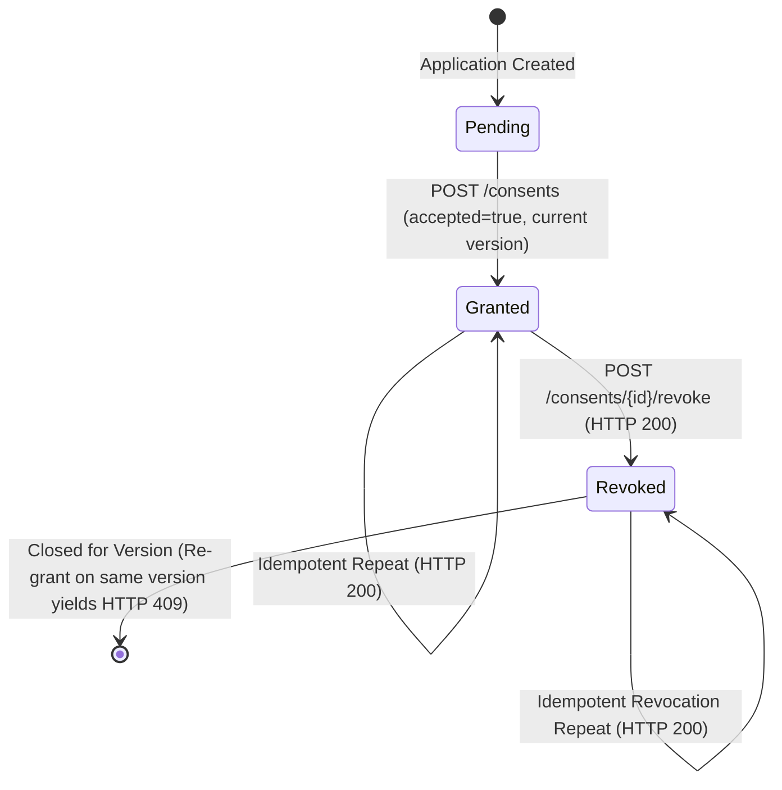

# Purpose-Specific Consent Management Specification

## 1. Overview and System Purpose

In modern regulated digital lending architectures, borrower consent cannot be obtained through generic, bundled, or indefinite blanket checkboxes. Regulatory and architectural best practices mandate **purpose-specific**, **version-controlled**, and **freely revocable** customer consent.

The **Mini Loan Marketplace** implements a dedicated consent audit ledger that ensures:
1. Consent is captured independently for explicit operational purposes.
2. Every granted consent links directly to an immutable notice version with an explicit timestamp.
3. Consent can be revoked at any time prior to final application submission.
4. Historical consent records are **never deleted**, preserving an immutable audit trail.
5. Automated policy matching engines evaluate consent readiness strictly at runtime against currently active versions before evaluating lender rules.

> [!IMPORTANT]
> **Fictional Simulation Notice**: All consent texts, notices, and workflows in this project are purely fictional training representations. No real credit bureaus (e.g. CIBIL, Experian), real lenders, or real OTP/SMS gateways are contacted, and no customer data is transmitted externally. This documentation does not represent legal or RupeeQ-approved consent wording.

---

## 2. The Two Demo Consent Purposes

The platform defines exactly two operational consent purposes:

| Purpose Identifier | Purpose Name | Scope & Operational Use | Required for Matching |
| :--- | :--- | :--- | :---: |
| `eligibility_matching` | Multi-Lender Eligibility Evaluation Consent | Authorizes evaluating fictional application parameters against three local simulated lender policy rules (*Apex Financial*, *Horizon Credit*, *Sterling Loans*) to produce illustrative matching results. | **Yes** |
| `sharing_with_mock_lenders` | Simulated Mock Lender Data Sharing Consent | Authorizes passing fictional application parameters to local mock lender integration adapters to simulate offer generation. | **Yes** |

Both purposes are mandatory before the system will allow multi-lender eligibility matching to proceed.

---

## 3. Notice Registry and Version Control

Defined in [`backend/app/services/consent_notices.py`](../backend/app/services/consent_notices.py):

- **Immutable Registry**: Notice wording is registered under composite keys `(purpose, notice_version)`. Once defined, notice text is immutable to guarantee that audit records reflect the exact text presented to the borrower at grant time.
- **Active Version Mapping**: The registry designates a currently published version for each purpose (initially `v1.0`).
- **Versioning Strategy**:
  - When legal disclosures or simulation parameters evolve, a new version (e.g. `v1.1` or `v2.0`) is published in the registry.
  - Grants must reference the **currently published version**. Requests referencing outdated or unrecognised versions are rejected with **HTTP 422**.
  - Historical records pointing to previous versions remain unaltered in the database.

---

## 4. Grant and Revocation Lifecycle

### A. Grant Workflow (`POST /api/v1/applications/{application_id}/consents`)
1. **Application Ownership**: Verifies that `application_id` belongs to the authenticated customer (`current_user.id`). Other customers receive **HTTP 404**.
2. **Lifecycle Gate**: Verifies that the loan application has not reached terminal submission (`status != 'submitted'`). Closed applications yield **HTTP 409**.
3. **Payload Validation**:
   - `purpose` must match a supported purpose.
   - `notice_version` must match the currently published active version.
   - `accepted` must be `true` (requests with `accepted=false` are rejected with HTTP 422).
4. **Idempotency & Re-grant Rules**:
   - If a consent record for `(application_id, purpose, notice_version)` already exists with `status="granted"`, it is returned with **HTTP 200 OK** without duplicate insertion.
   - If that same version was previously revoked, the server rejects re-grant with **HTTP 409 Conflict**. A customer may only grant consent anew when a fresh notice version is published.
   - If no record exists, a new record is inserted with `status="granted"`, `granted_at=now_utc`, and `revoked_at=NULL` (**HTTP 201 Created**).

### B. Revocation Workflow (`POST /api/v1/applications/{application_id}/consents/{consent_id}/revoke`)
1. **Ownership & Scope**: Validates that both the application and consent belong to the authenticated customer and each other.
2. **Pre-Submission Check**: Consent can be revoked during any pre-submission state (`draft`, `matching`, `matched`, `offers_ready`, `offer_selected`). Once submitted, consent changes are blocked (**HTTP 409**).
3. **Audit Preservation**: The row is **never deleted**. `status` transitions from `granted` to `revoked`, and `revoked_at` is set to UTC now. `granted_at` and `notice_version` remain intact.
4. **Idempotent Revocation**: Calling revoke on an already-revoked consent safely returns the existing revoked record (**HTTP 200 OK**).

---

## 5. Consent Audit History

The `GET /api/v1/applications/{application_id}/consents` endpoint returns the complete chronological audit log of all consent actions taken on an application. Both active and historically revoked records remain visible, providing transparent traceability for compliance audits.

---

## 6. Matching Readiness Service

The matching engine (to be implemented in Step 8) relies on the consent service to verify prerequisite borrower authorization before evaluating simulated policy rules:

- **`has_required_active_consents(db, application_id) -> bool`**:
  - Verifies that all required purposes (`eligibility_matching`, `sharing_with_mock_lenders`) have active `status="granted"` records.
  - Asserts that every granted consent corresponds to the **currently published notice version** (`v1.0`). If a consent was granted on an obsolete version, or if either required purpose was revoked, the function immediately returns `False`.
- **`get_missing_required_consents(db, application_id) -> List[str]`**:
  - Returns the list of unfulfilled or revoked purpose codes, allowing the API to provide targeted diagnostic feedback.

---

## 7. Customer Ownership and Privacy Boundaries

- **Authentication Coupling**: No endpoint accepts `customer_id` from request bodies or parameters; it is always extracted from the cryptographically verified JWT (`current_user.id`).
- **Anti-Enumeration HTTP 404**: Inquiries on applications or consents belonging to other customers return `HTTP 404 Not Found`, giving zero indication of whether foreign IDs exist.
- **RBAC**: Callers and Administrators are strictly prevented from viewing or modifying customer consents (**HTTP 403 Forbidden**).
