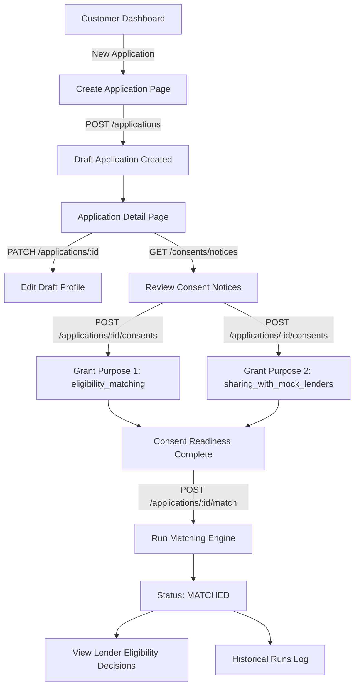

# Customer Application, Consent Management, and Matching Workflow

> **FICTIONAL DEMO / TRAINING DISCLAIMER**:
> This project is a fictional training simulation. No actual credit checks, bureau requests, payment gateways, or real lender/banking institutions are integrated. All lender policies, decisions, and documents are local mocks for development and educational purposes.

---

## 1. Overview & Customer Journey

Step 13B implements the customer loan application lifecycle in the React 18 TypeScript frontend, connected to the FastAPI backend services.

The customer journey spans four key phases:
1. **Application Creation**: Form-based creation of a draft loan application.
2. **Draft Editing**: In-place modification of loan parameters while in `draft` status.
3. **Purpose-Specific Consent Management**: Explicit, separate review and granting of published consent notices.
4. **Deterministic Multi-Lender Matching**: Multi-policy eligibility evaluation against fictional mock lenders with full run history.



---

## 2. Customer Application Creation

- **Route**: `/customer/applications/new`
- **Component**: [`CreateApplicationPage`](../frontend/src/features/customer/pages/CreateApplicationPage.tsx)
- **API Endpoint**: `POST /api/v1/applications`
- **Initial Lifecycle Status**: `draft`

### Form Fields & Validation Rules

| Field | Type | Client Validation | Backend Constraints | Description |
| :--- | :--- | :--- | :--- | :--- |
| **Age** | Integer | Whole number between 1 and 120 | Integer, `1 <= age <= 120` | Applicant age in years |
| **Employment Type** | Enum | Selection required | `'salaried' \| 'self_employed' \| 'other'` | Applicant work status |
| **Monthly Income** | Decimal | Non-negative decimal, $\le 2$ decimal places, $\le 12$ digits | `Decimal >= 0`, 2 decimal places | Monthly net income in ₹ |
| **Requested Amount** | Decimal | Positive decimal ($> 0$), $\le 2$ decimal places, $\le 12$ digits | `Decimal > 0`, 2 decimal places | Loan principal requested in ₹ |

> **Security & Ownership**: The request payload **strictly omits** `customer_id`, `user_id`, or `status`. Customer ownership is automatically derived by the backend from the Bearer JWT token in the `Authorization` header.

On successful creation, the frontend receives HTTP 201 with the created [`LoanApplication`](../frontend/src/features/customer/types.ts) and navigates to `/customer/applications/:applicationId`.

---

## 3. Application Detail & Draft Editing

- **Route**: `/customer/applications/:applicationId`
- **Component**: [`ApplicationDetailPage`](../frontend/src/features/customer/pages/ApplicationDetailPage.tsx)
- **API Endpoint**: `GET /api/v1/applications/:applicationId`, `PATCH /api/v1/applications/:applicationId`

### Draft vs Non-Draft Rules

1. **When in `draft` status**:
   - The application profile is editable.
   - The customer can adjust Age, Employment Type, Monthly Income, and Requested Amount.
   - Clicking **Save Changes** sends a `PATCH` request with only permitted editable fields.
2. **When not in `draft` status** (e.g., `matched`, `offer_selected`, `submitted`, etc.):
   - Profile inputs are rendered as read-only formatted metrics.
   - An informational notice explains that the application has advanced beyond draft and is locked against modifications.
   - Any attempt to update a non-draft returns HTTP 409 `Conflict`, displayed cleanly to the customer.

---

## 4. Purpose-Specific Consent Management

- **API Endpoints**:
  - `GET /api/v1/consents/notices` — Loads published consent notices.
  - `GET /api/v1/applications/:id/consents` — Loads full chronological audit history.
  - `POST /api/v1/applications/:id/consents` — Grants consent for a specific notice version.
  - `POST /api/v1/applications/:id/consents/:id/revoke` — Revokes an active consent.

### Published Consent Notices (v1.0)

1. `eligibility_matching`: Authorizes evaluating applicant data against multi-lender credit and underwriting policies.
2. `sharing_with_mock_lenders`: Authorizes transmitting financial parameters to fictional participating mock lenders.

Both notices are required (`required_for_matching=true`) for the matching engine to proceed.

### Consent Workflow & Disclosures

- **Separate Acceptance**: Each consent notice is presented in its own [`ConsentNoticeCard`](../frontend/src/features/consents/components/ConsentNoticeCard.tsx) with unchecked checkboxes by default.
- **Version Pinning**: Consents are recorded against exact published versions (e.g. `v1.0`). An older or outdated notice version does not fulfill readiness.
- **Revocation Safety**: Revoking an active consent triggers a prominent confirmation warning detailing that future matching will be blocked.
- **Re-grant Limitation**: In accordance with platform governance, **once a consent record is revoked, the same notice version cannot be re-granted** (returns HTTP 409). A new grant requires a newly published notice version from the administrator.

---

## 5. Mock Lender Eligibility Matching

- **API Endpoints**:
  - `POST /api/v1/applications/:applicationId/match` — Executes deterministic multi-lender policy rules.
  - `GET /api/v1/applications/:applicationId/matches` — Retrieves all historical matching runs.

### Matching Readiness Guard

The frontend helper [`getConsentReadiness`](../frontend/src/features/consents/utils/consentReadiness.ts) verifies:
- All notices where `required_for_matching === true` have an active, unrevoked consent record.
- Every record matches the current notice version (`v1.0`).

If readiness is incomplete, the **Run Lender Matching** button is disabled, and an informative banner lists the specific missing purposes.

### Matching Execution & Multi-Run History

1. **Deterministic Evaluation**: The backend runs the application attributes against active mock lender policies:
   - **Alpha Bank Mock Policy**: Evaluates age, income, and requested amount thresholds.
   - **Beta Finance Mock Policy**: Evaluates stricter salary requirements.
   - **Gamma Capital Mock Policy**: Evaluates flexible self-employed and credit risk boundaries.
2. **Lender Decisions**: Each evaluation returns:
   - Lender Code and Name
   - Policy Version Snapshot
   - Decision Status (`ELIGIBLE` or `INELIGIBLE`)
   - Exclusion Reason and Code (e.g. `[MIN_INCOME_NOT_MET] Monthly income below threshold of 30,000`)
3. **Multi-Run History**:
   - Matching may be re-run while in `draft` or `matched` status.
   - Historical matching executions are preserved in chronological order.
   - The user interface sorts newest runs first and tags the latest run with a **Latest Run** indicator.

---

## 6. Running Frontend Tests & Local Development

### Running Frontend Tests
```bash
cd frontend
npm test -- --run
```
All 56 unit and integration tests across 9 test suites run using Vitest and React Testing Library:
- `CreateApplicationPage.test.tsx` (8 tests)
- `ApplicationDetailPage.test.tsx` (6 tests)
- `ConsentManagement.test.tsx` (7 tests)
- `MatchingWorkflow.test.tsx` (6 tests)
- `Dashboards.test.tsx` (5 tests)
- `RouteGuards.test.tsx` (8 tests)
- `LoginForm.test.tsx` (7 tests)
- `RegisterForm.test.tsx` (3 tests)
- `apiClient.test.ts` (6 tests)

### TypeScript Typechecking & Linting
```bash
cd frontend
npm run typecheck
npm run lint
npm run build
```

### Running Backend Pytest Suite
```bash
cd backend
.venv/bin/python -m pytest -v
```
All 310 backend tests pass.

### Running Applications Locally
1. **Backend**:
   ```bash
   cd backend
   source .venv/bin/activate
   uvicorn app.main:app --reload --port 8000
   ```
2. **Frontend**:
   ```bash
   cd frontend
   npm run dev
   ```
   Open `http://localhost:5173` in your browser.

---

## 7. Deferred Features (Future Steps)

The following components are intentionally deferred to subsequent frontend steps:
- Mock Offer generation and comparison screens (Step 14A).
- Mock Key Facts Statement (KFS) viewer (Step 14B).
- Customer offer selection and idempotent submission UI (Step 14C).
- Caller workspace and lead assignment UI.
- Administrator configuration and policy versioning screens.
