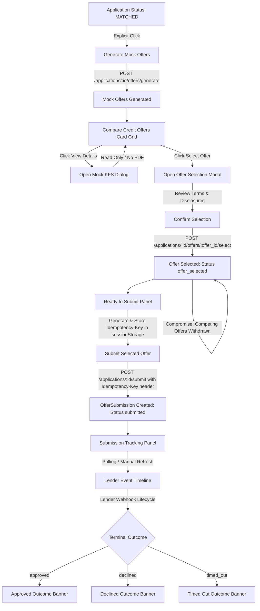

# Customer Offer Comparison, Mock KFS, Selection, Submission, and Event Tracking Workflow

> **FICTIONAL DEMO / TRAINING DISCLAIMER**:
> This project is a fictional software training simulation. No actual credit checks, bureau requests, payment gateways, or real lender/banking institutions are integrated. All lender policies, decisions, offers, Key Facts Statements, and webhook events are local mocks for development and educational purposes.

---

## 1. Overview & Customer Journey

Step 13C completes the customer-facing lifecycle in the Mini Loan Marketplace React application, orchestrating the journey from post-matching credit offer generation to final simulated lender outcome tracking.



---

## 2. Mock Offer Generation

- **API Endpoint**: `POST /api/v1/applications/{application_id}/offers/generate`
- **Component**: [`OfferComparisonSection`](../frontend/src/features/offers/components/OfferComparisonSection.tsx)
- **Service**: [`offerService.generateOffers`](../frontend/src/features/offers/services/offerService.ts)

### Generation Rules & Guards
1. **Explicit Customer Action**: Offer generation is never triggered automatically upon page render or URL navigation. The applicant must explicitly click **"Generate Mock Offers"**.
2. **Pre-requisite Status**: Requires the application to be in `matched` status with active purpose consents.
3. **Deterministic Policy Calculations**: Generates pre-qualified mock loan offers for every eligible lender decision from the latest completed match run.
4. **Clean Re-generation**: If offers already exist, re-running generates updated terms based on the current policy version snapshots without duplicating previous batches.

---

## 3. Offer Comparison Interface

- **Component**: [`OfferCard`](../frontend/src/features/offers/components/OfferCard.tsx)
- **Key Display Metrics**:
  - **Lender Information**: Real lender name (e.g., `Apex Financial`, `Sterling Loans`), lender code (`APEX_FINANCIAL`), and snapshot policy version (`v1.0`).
  - **Loan Principal**: Formatted using decimal-safe Indian rupee notation (e.g., `₹2,00,000.00`).
  - **Annual Percentage Rate (APR)**: Formatted percentage (e.g., `14.5%`).
  - **Tenure & Monthly Installment (EMI)**: Exact term in months and monthly installment (e.g., `24 Months` at `₹9,648.50/mo`).
  - **Status Badges**: Visual indicator of offer status (`available`, `selected`, `withdrawn`, `expired`).
  - **Actions**:
    - **"View KFS Details"**: Opens the Key Facts Statement dialog.
    - **"Select This Offer"**: Available exclusively when the offer is in `available` status and no other offer is currently selected.

---

## 4. Decimal-Safe Currency & APR Formatting

To guarantee financial precision and prevent floating-point rounding errors (e.g., `0.1 + 0.2 = 0.30000000000000004`), all monetary inputs, calculations, and displays use string-based decimal manipulation:

- **Utility Module**: [`frontend/src/features/offers/utils/formatMoney.ts`](../frontend/src/features/offers/utils/formatMoney.ts)
- **Functions**:
  - `formatRupees(amount: string | number | null | undefined): string`:
    - Handles standard Indian numbering grouping: hundreds followed by groups of two digits (e.g., `1234567.89` $\rightarrow$ `₹12,34,567.89`).
    - Strictly avoids `parseFloat()` or `Number.prototype.toLocaleString()` with float inputs.
    - Preserves exact cents / paise decimals.
  - `formatApr(apr: string | number | null | undefined): string`:
    - Trims trailing zeroes while preserving meaningful decimals (e.g., `14.50` $\rightarrow$ `14.5%`, `20.00` $\rightarrow$ `20%`).
- **Input Validation**: [`frontend/src/features/customer/utils/validators.ts`](../frontend/src/features/customer/utils/validators.ts) replaces legacy `parseFloat` calls with exact regex validations (`isPositiveDecimal`, `isNonNegativeDecimal`).

---

## 5. Mock Key Facts Statement (KFS) Dialog

- **API Endpoint**: `GET /api/v1/applications/{application_id}/offers/{offer_id}/kfs`
- **Component**: [`MockKFSDialog`](../frontend/src/features/offers/components/MockKFSDialog.tsx)
- **Modal Accessibility**:
  - ARIA attributes: `role="dialog"`, `aria-modal="true"`, `aria-labelledby="mock-kfs-title"`.
  - Keyboard listener: Dismisses cleanly on `Escape` key press.
  - Backdrop dismissal: Clicking the backdrop dismisses the dialog.
- **Content & Breakdown**:
  - **Document Identifier**: Displays unique mock KFS document reference (e.g., `KFS-APEX-998877`).
  - **Simulation Warning Banner**: Clear notice stating that the statement is an educational software simulation, not a real financial contract.
  - **Comprehensive Cost Breakdown**:
    - Loan Principal (Disbursed Amount).
    - APR & Nominal Interest Rate.
    - Total Loan Tenure & Number of Installments.
    - Monthly Installment (EMI).
    - Total Amount Payable over Loan Life.
    - Total Cost of Credit (Total Payable minus Principal).
  - **Regulatory Prohibition**: Strictly no PDF download button or fake export link is rendered.

---

## 6. Offer Selection Workflow

- **API Endpoint**: `POST /api/v1/applications/{application_id}/offers/{offer_id}/select`
- **Component**: [`OfferSelectionPanel`](../frontend/src/features/offers/components/OfferSelectionPanel.tsx)
- **Selection Semantics**:
  1. **Strict Exclusivity**: A customer may select exactly **one** offer per loan application.
  2. **Automatic Competing Offer Withdrawal**: Selecting an offer atomically transitions all other active offers for that match run to `withdrawn` status.
  3. **Application Lifecycle Progression**: The application's status moves from `matched` $\rightarrow$ `offer_selected`.
  4. **Confirmation Modal**: Before executing the selection request, the customer is presented with an explicit confirmation dialog detailing the selected terms and reminding them that selection does not constitute final lender approval.
  5. **Conflict Handling**: If another offer has already been selected, the API returns HTTP 409 Conflict, which the UI renders as a prominent error notice.

---

## 7. Cryptographically Secure Idempotency Key Handling

- **Service Module**: [`frontend/src/features/submissions/services/submissionService.ts`](../frontend/src/features/submissions/services/submissionService.ts)
- **Key Generation**:
  - Primary: Uses `window.crypto.randomUUID()` when supported by the browser environment.
  - Fallback: Uses `window.crypto.getRandomValues(new Uint8Array(16))` formatted according to RFC 4122 v4 UUID specifications.
- **Session Persistence**:
  - Stored in browser `sessionStorage` under `mini-loan-marketplace:submission:{applicationId}`.
  - **Survives Reloads**: If the customer reloads the page or loses connectivity while a submission is pending, the same idempotency key is preserved, preventing duplicate loan requests.
  - **Clean Clearance**: Upon receiving a successful HTTP 201 or 200 response from the submission endpoint, the key is immediately cleared from `sessionStorage`.

---

## 8. Offer Submission Workflow

- **API Endpoint**: `POST /api/v1/applications/{application_id}/submit`
- **HTTP Header**: `Idempotency-Key: <uuid-v4>`
- **Request Body**: strictly empty or contains zero applicant PII / user identifiers (derived entirely from token and application state).
- **Backend Behavior**:
  - Verifies application is in `offer_selected` status.
  - Verifies authenticated customer ownership.
  - Dispatches mock dispatch to fictional lender adapter.
  - Creates `OfferSubmission` record with status `submitted`.
  - Transitions application status to `submitted`.

---

## 9. Read-Only Submission Status API

To allow the frontend to reload application state and restore submission tracking after page refresh:

- **API Endpoint**: `GET /api/v1/applications/{application_id}/submission`
- **Response Model**: `Optional[OfferSubmissionStatusResponse]`
  - Returns HTTP 200 with JSON serialization of `OfferSubmissionStatusResponse` if a submission exists.
  - Returns HTTP 200 with JSON `null` if no submission has been initiated yet.
  - Returns HTTP 404 if the application does not exist or does not belong to the authenticated user.
- **Backend Implementation**:
  - Model: [`backend/app/schemas/offer.py`](../backend/app/schemas/offer.py)
  - Service: [`submission_service.get_application_submission_status`](../backend/app/services/submission_service.py) with eager joined loading of `Offer`, `LenderDecision`, and `LenderPolicy` to eliminate N+1 queries.
  - Router: Mounted on [`backend/app/api/v1/submissions.py`](../backend/app/api/v1/submissions.py).

---

## 10. Submission Status & Lifecycle Tracking

- **Component**: [`SubmissionStatusPanel`](../frontend/src/features/submissions/components/SubmissionStatusPanel.tsx)
- **Lifecycle Statuses**:
  - `submitted`: Application dispatched to mock lender engine, waiting for simulated processing.
  - `processing`: Lender review initiated.
  - `approved`: Fictional lender approved the submission.
  - `declined`: Fictional lender declined the submission based on simulated underwriting criteria.
  - `timed_out`: Mock lender response timed out.
  - `withdrawn`: Applicant withdrew or superseded submission.
- **Post-Submission Locks**: Once a submission record exists, all further submission buttons, offer selections, and offer generation triggers are permanently locked.

---

## 11. Simulated Lender Event Timeline & Ledger

- **API Endpoint**: `GET /api/v1/submissions/{submission_id}/events`
- **Component**: [`LenderEventTimeline`](../frontend/src/features/submissions/components/LenderEventTimeline.tsx)
- **Event Audit Display**:
  - Chronological timeline displaying event sequencing (1, 2, 3...).
  - Event types: `underwriting_started`, `document_verified`, `decision_rendered`, `funds_scheduled`.
  - Occurred timestamp formatted in local readable format.
  - Sanitized event payload details (e.g., decision reason codes).
- **Security & Privacy Safeguards**:
  - **Zero Secrets / Signatures**: Webhook signatures, secret tokens, and cryptographic keys are strictly excluded from event models and client payloads.
  - **Zero PII**: Customer personal identifiable information (name, email, PAN, salary numbers) is completely omitted from the event ledger.

---

## 12. Terminal Outcome Banners & Explanations

When a submission reaches a terminal state, the UI presents a contextual status banner explaining the simulated outcome:

| Terminal Status | UI Badge | Banner Variant | Explanation Message |
| :--- | :--- | :--- | :--- |
| **`approved`** | Success (Green) | Alert Success | Simulated loan application was approved by the mock lender. Reference funds scheduled for demonstration disbursement. |
| **`declined`** | Danger (Red) | Alert Danger | Mock lender declined the submission based on fictional risk thresholds. Review eligibility or consider adjusting requested terms. |
| **`timed_out`** | Warning (Amber) | Alert Warning | Simulated lender webhook response timed out. In a live system, support or automated reconciliations would resolve this state. |
| **`withdrawn`** | Neutral (Gray) | Alert Info | Application or offer submission was withdrawn. |

---

## 13. Application Detail Page Lifecycle Orchestration

The customer application detail view ([`ApplicationDetailPage`](../frontend/src/features/customer/pages/ApplicationDetailPage.tsx)) orchestrates the 8 lifecycle sections in strict progression:

```
┌─────────────────────────────────────────────────────────────┐
│ 1. Header (Application ID, Status Badge, Metadata)           │
├─────────────────────────────────────────────────────────────┤
│ 2. Applicant Profile & Parameters (Draft / Read-only)        │
├─────────────────────────────────────────────────────────────┤
│ 3. Purpose Consents & Readiness Matrix                      │
├─────────────────────────────────────────────────────────────┤
│ 4. Deterministic Multi-Lender Matching & Eligibility        │
├─────────────────────────────────────────────────────────────┤
│ 5. Mock Offers Comparison & Key Facts Statements            │
├─────────────────────────────────────────────────────────────┤
│ 6. Ready-to-Submit Panel (Active when offer_selected)       │
├─────────────────────────────────────────────────────────────┤
│ 7. Submission Status & Lifecycle Panel                      │
├─────────────────────────────────────────────────────────────┤
│ 8. Simulated Lender Event Ledger Timeline                   │
└─────────────────────────────────────────────────────────────┘
```

---

## 14. Verification & Automated Test Coverage

The end-to-end workflow is validated through extensive automated test suites across both frontend and backend stacks:

### Frontend Vitest Suite (95 tests passing across 16 files)
- [`formatMoney.test.ts`](../frontend/src/features/offers/__tests__/formatMoney.test.ts): 4 unit tests validating Indian grouping, zero float errors, and APR formatting.
- [`validators.test.ts`](../frontend/src/features/customer/__tests__/validators.test.ts): 10 unit tests validating non-negative and positive decimals without `parseFloat`.
- [`submissionService.test.ts`](../frontend/src/features/submissions/__tests__/submissionService.test.ts): 7 unit tests verifying UUID generation, `sessionStorage` caching, reload survival, and clearance on success.
- [`OfferComparisonSection.test.tsx`](../frontend/src/features/offers/__tests__/OfferComparisonSection.test.tsx): 6 integration tests verifying offer generation on click, empty states, and card rendering.
- [`MockKFSDialog.test.tsx`](../frontend/src/features/offers/__tests__/MockKFSDialog.test.tsx): 4 component tests validating modal behavior, keyboard `Escape`, cost calculations, and PDF absence.
- [`OfferSelectionPanel.test.tsx`](../frontend/src/features/offers/__tests__/OfferSelectionPanel.test.tsx): 3 component tests validating confirmation flow, 409 conflict handling, and cancellation.
- [`SubmissionTracking.test.tsx`](../frontend/src/features/submissions/__tests__/SubmissionTracking.test.tsx): 5 tests validating ready-to-submit state, submission details, outcome banners, and timeline rendering without secrets.
- [`ApplicationDetailPage.test.tsx`](../frontend/src/features/customer/__tests__/ApplicationDetailPage.test.tsx): 6 integration tests validating full page loading, editing, lock behavior, and error recovery.

### Backend Pytest Suite (311 tests passing across 16 test modules)
- [`test_submissions.py`](../backend/tests/test_submissions.py): 17 tests validating idempotent submission, Idempotency-Key headers, customer scoping, and `GET /applications/{id}/submission`.
- [`test_offers.py`](../backend/tests/test_offers.py): 24 tests validating mock offer generation, policy snapshotting, and exclusion logic.
- [`test_offer_selection.py`](../backend/tests/test_offer_selection.py): 27 tests validating atomic selection, auto-withdrawal of competing offers, and single-offer constraints.
- [`test_mock_kfs.py`](../backend/tests/test_mock_kfs.py): 15 tests validating KFS calculations, fee breakdowns, and educational disclosures.
- [`test_lender_events.py`](../backend/tests/test_lender_events.py): 19 tests validating signed webhooks, lifecycle sequencing, duplicate event deduplication, and HMAC verification.
