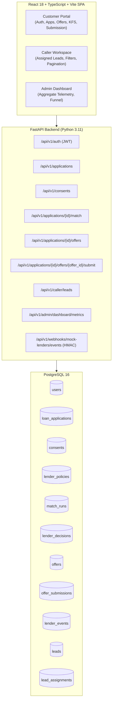
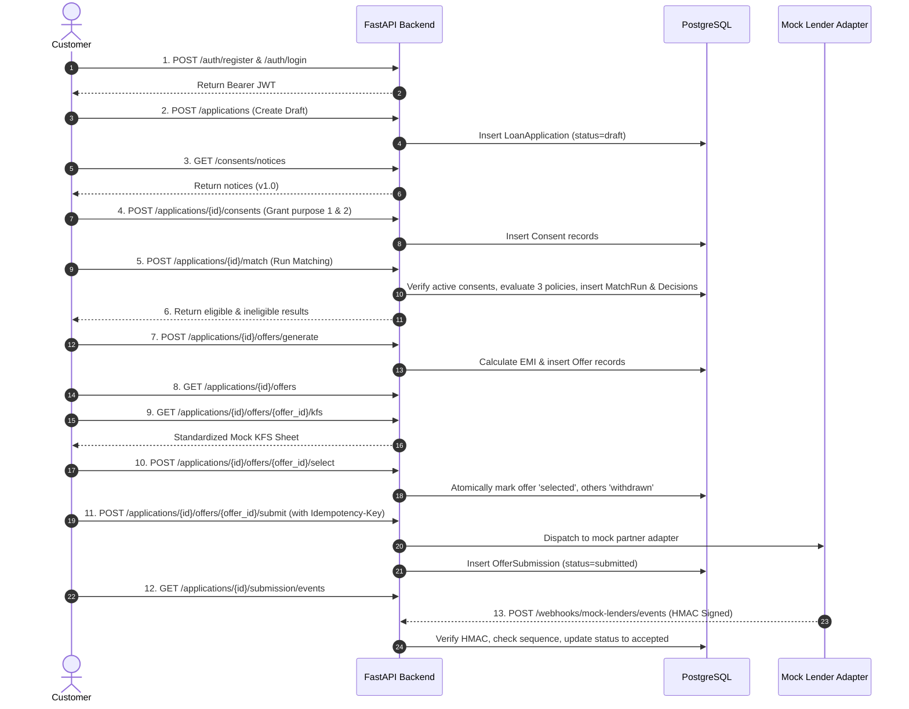

# Final Acceptance & Capstone Integration Audit Report

> [!NOTE]
> **Fictional Educational Project Disclosure**:
> The **Mini Loan Marketplace** is an educational, simulated software architecture project designed for capstone learning and evaluation. It **does not** connect to real banks, licensed lenders, credit rating agencies, payment networks, or regulatory bodies. Key Facts Statements (KFS) and mock lender decisions are synthetic simulations and **do not** constitute real financial or legal disclosures.

---

## 1. Project Overview

The **Mini Loan Marketplace** is a full-stack financial technology demonstration platform. It simulates an end-to-end multi-lender credit discovery and application lifecycle across three distinct stakeholder roles:
1. **Customer**: Self-service registration, loan application creation, purpose-specific consent management, multi-lender eligibility matching, offer comparison, mock Key Facts Statement (KFS) inspection, offer selection, and idempotent mock offer submission.
2. **Caller**: Dedicated lead workspace providing strict assignment-scoped lead viewing, case-insensitive search, status/work-type filtering, and pagination without mutation or cross-caller access.
3. **Administrator**: Privacy-preserving operational monitoring dashboard reporting aggregate funnel telemetry, application statuses, and mock lender webhook event processing outcomes without exposing customer PII.

---

## 2. Architecture



---

## 3. Three Role-Based Workflows

### 3.1 Customer Workflow
- Registers and authenticates via email and password (JWT access tokens with 30-minute expiry).
- Manages draft applications with numeric parameters (age, income, requested amount, employment type).
- Grants or revokes purpose-specific demo consent notices before eligibility matching.
- Explores eligible lender policies, compares APR, tenure, EMI, and inspects standardized mock Key Facts Statements.
- Selects an offer and submits with an idempotent submission key.
- Observes real-time status progression from `submitted` to terminal simulated outcomes (`accepted`, `declined`, `timed_out`, `failed`).

### 3.2 Caller Assigned-Lead Workflow
- Logs into a role-scoped workspace.
- Retrieves only leads explicitly assigned in `lead_assignments` where `caller_id == current_user.id`.
- Performs client/server-side search by applicant name or synthetic reference ID.
- Applies status and employment-type filters.
- Strictly read-only; cannot reassign leads, edit customer applications, or access administrator metrics.

### 3.3 Admin Aggregate Monitoring Workflow
- Authenticates into an executive oversight dashboard.
- Retrieves high-level funnel metrics: total leads, applications, match runs, generated offers, and submissions.
- Inspects status breakdowns across draft, submitted, accepted, declined, and timed-out states.
- Reconciles submission volume with downstream webhook event counts.
- Preserves absolute customer privacy: zero customer names, email addresses, phone numbers, or individual income amounts are delivered by the API.

---

## 4. Customer End-to-End Lifecycle (13 Deterministic Steps)



---

## 5. Caller Assigned-Lead Workflow

- **Endpoint**: `GET /api/v1/caller/leads?limit=50&offset=0`
- **Security Guard**: `require_caller` dependency enforces `role == "caller"`.
- **Database Query**:
  ```sql
  SELECT leads.* FROM leads
  JOIN lead_assignments ON leads.id = lead_assignments.lead_id
  WHERE lead_assignments.caller_id = :current_user_id
  ORDER BY leads.id ASC LIMIT :limit OFFSET :offset;
  ```
- **Boundary Verification**: Attempting to query another caller's leads or pass an arbitrary caller ID is blocked because the query binds directly to `current_user.id` extracted from the verified JWT.

---

## 6. Admin Aggregate Monitoring Workflow

- **Endpoint**: `GET /api/v1/admin/dashboard/metrics`
- **Security Guard**: `require_admin` dependency enforces `role == "admin"`.
- **Database Aggregation**:
  ```sql
  SELECT count(*) FROM loan_applications;
  SELECT status, count(*) FROM loan_applications GROUP BY status;
  SELECT processing_status, count(*) FROM lender_events GROUP BY processing_status;
  ```
- **Privacy Verification**: Schema response is strictly typed to `AdminDashboardSummary`. Customer personal identifiers are structurally excluded from the SQL projections and Pydantic schemas.

---

## 7. Backend API Groups

| API Router | Route Prefix | Primary Purpose | Auth Required | Permitted Roles |
| :--- | :--- | :--- | :--- | :--- |
| **Auth** | `/api/v1/auth` | Customer registration, login, profile retrieval (`/me`) | No (except `/me`) | All (public registration creates `customer`) |
| **Applications** | `/api/v1/applications` | Draft application creation, listing, updating | Yes | `customer` |
| **Consents** | `/api/v1/consents` & `/api/v1/applications/{id}/consents` | Published notices, granular consent granting, audit history, revocation | Yes | `customer` |
| **Matching** | `/api/v1/applications/{id}/match` | Evaluate active lender underwriting policies, record decisions | Yes | `customer` |
| **Offers** | `/api/v1/applications/{id}/offers` | Offer generation, listing, mock KFS disclosure, offer selection | Yes | `customer` |
| **Submissions** | `/api/v1/applications/{id}/offers/{offer_id}/submit` | Idempotent dispatch, submission status query, event timeline audit | Yes | `customer` |
| **Caller** | `/api/v1/caller` | Assigned lead listing, filtering, search, pagination | Yes | `caller` |
| **Admin** | `/api/v1/admin` | Aggregate funnel telemetry, processing delays | Yes | `admin` |
| **Webhooks** | `/api/v1/webhooks/mock-lenders` | Inbound asynchronous simulated lender events | No (HMAC Signed) | External Simulated Lenders |

---

## 8. Database Entities & Schema Constraints

| Entity / Table | Purpose | Primary Key | Key Constraints & Indexes |
| :--- | :--- | :--- | :--- |
| `users` | Accounts for customers, callers, admins | `id` (BigInteger) | `email` (Unique, Index), `CHECK (role IN ('customer', 'caller', 'admin'))` |
| `leads` | Mock lead records | `id` (BigInteger) | `synthetic_reference` (Unique, Index), `CHECK (age > 0, monthly_income >= 0, requested_amount > 0)` |
| `lead_assignments` | Maps leads to designated callers | `id` (BigInteger) | `lead_id` (Unique, FK -> leads), `caller_id` (FK -> users) |
| `loan_applications`| Loan application state machine | `id` (BigInteger) | `customer_id` (FK -> users), `lead_id` (Nullable FK -> leads), CHECK constraints on amounts |
| `consents` | Immutable consent audit log | `id` (BigInteger) | `UNIQUE(application_id, purpose, notice_version)`, `CHECK (status IN ('pending', 'granted', 'revoked'))` |
| `lender_policies` | Versioned underwriting rules & offer terms | `id` (BigInteger) | `UNIQUE(lender_code, policy_version)`, JSONB `rules` & `offer_terms` |
| `match_runs` | Record of policy evaluation executions | `id` (BigInteger) | `UNIQUE(application_id, run_number)`, `consent_id` (FK -> consents) |
| `lender_decisions` | Granular policy outcome per lender | `id` (BigInteger) | `UNIQUE(match_run_id, lender_policy_id)`, check constraint linking status and exclusion reasons |
| `offers` | Credit offers extended to customer | `id` (BigInteger) | `lender_decision_id` (Unique, FK -> decisions), Numeric(12,2) loan_amount, Numeric(7,4) apr |
| `offer_submissions`| Record of dispatched offer | `id` (BigInteger) | `application_id` (Unique), `offer_id` (Unique), `idempotency_key` (Unique) |
| `lender_events` | Asynchronous webhook audit log | `id` (BigInteger) | `event_id` (Unique, Index), `submission_id` (FK -> submissions), JSONB `event_payload` |

---

## 9. Mock Lender Adapter Design

The mock lender adapter (`backend/app/services/mock_lender_adapter.py`) provides local, deterministic simulation without external network calls:
- **No Outbound HTTP Requests**: Adapters execute entirely within the local process runtime.
- **Deterministic Mock References**: Generates synthetic references with pattern `MOCK-{lender_code}-{uuid[:8]}`.
- **Configurable Simulation Flags**: Supports simulated network latency and individual lender enablement toggles (`ENABLE_MOCK_LENDER_APEX`, `ENABLE_MOCK_LENDER_HORIZON`, `ENABLE_MOCK_LENDER_STERLING`).
- **Safe Fallback**: If an unsupported lender code is dispatched, raises structured `MockLenderAdapterError` triggering safe transaction rollback.

---

## 10. HMAC Webhook Design

Incoming webhook events from simulated lenders must authenticate via SHA-256 HMAC signatures:
- **Header**: `X-Mock-Lender-Signature: sha256=<hex_digest>`
- **Digest Algorithm**: `hmac.new(secret.encode("utf-8"), raw_body_bytes, hashlib.sha256).hexdigest()`
- **Constant-Time Verification**: Verification utilizes `hmac.compare_digest` to prevent timing attacks.
- **Fail-Closed Security**: Missing signatures, malformed formats, or absent secrets immediately return HTTP 401 Unauthorized or HTTP 503 Service Unavailable before any JSON deserialization or database transactions occur.

---

## 11. Idempotency & Event Sequencing

### 11.1 Client Offer Submission Idempotency
- Requires mandatory `Idempotency-Key` HTTP header (8 to 128 characters).
- Frontend persists key across navigation in `sessionStorage` with an in-memory fallback map if storage is restricted.
- Backend looks up `OfferSubmission` by `idempotency_key`. If found with matching application and offer, returns existing submission with `"submission_result": "replayed"`.
- If key matches a different offer or application, returns HTTP 409 Conflict.

### 11.2 Webhook Idempotency & Monotonic Sequencing
- Inbound webhooks specify unique `event_id` and monotonic `sequence_number`.
- **Exact Replay**: If `event_id` is re-received with identical payload, returns HTTP 200 with `"duplicate": true` and `"processing_status": "processed"` without inserting a duplicate row.
- **Payload Conflict**: If `event_id` is reused with different payload parameters, returns HTTP 409 Conflict.
- **Out-of-Order / Stale Events**: If an incoming event has `sequence_number <= max_processed_sequence`, it is recorded with `"processing_status": "ignored"` and leaves application and submission lifecycle statuses untouched.

---

## 12. Security & Privacy Boundaries

1. **Role-Based Access Control (RBAC)**: Enforced through FastAPI dependency injection (`require_customer`, `require_caller`, `require_admin`).
2. **Customer Isolation**: All customer endpoints bind to `current_user.id` extracted from JWT claims. Accessing another customer's application returns HTTP 404 Not Found to prevent resource enumeration.
3. **Caller Boundary**: Callers only query assigned leads via database joins against `lead_assignments`.
4. **Admin Privacy Safeguards**: Zero customer names, emails, phones, or individual salaries are delivered in admin responses.
5. **Secret Handling**: Zero secrets committed to source control; `.env` is strictly `.gitignore`d.
6. **No Password Exposure**: Passwords hashed using Argon2; Pydantic models use `SecretStr` to prevent accidental logging.
7. **Monetary Precision**: All financial calculations use Python `Decimal` and SQL `Numeric(12, 2)` / `Numeric(7, 4)`. Floating-point values are strictly rejected.

---

## 13. Testing Strategy

The marketplace test architecture is stratified across three independent layers:
1. **Frontend Unit & Component Tests (Vitest + React Testing Library)**:
   - 141 tests covering customer application forms, consent modals, matching triggers, offer comparison, KFS modal disclosures, submission tracking, caller lead tables, and admin metrics dashboard.
2. **Backend Unit & Integration Tests (Pytest)**:
   - 311 tests covering authentication, RBAC boundaries, consent notice auditing, policy rule parsing, decimal financial calculations, idempotent submissions, and HMAC webhook signature checks.
3. **Dedicated End-to-End Acceptance Tests (Pytest on Isolated DB)**:
   - 12 comprehensive E2E tests executing the full 28-step customer journey, four terminal outcome paths (`accepted`, `declined`, `timed_out`, `failed`), and multi-role isolation checks against a dedicated PostgreSQL database (`mini_loan_marketplace_e2e`).
4. **Browser E2E Specifications (Playwright)**:
   - 3 test suites written under `frontend/e2e/` defining automated browser journeys for Customer, Caller, and Admin workflows.

---

## 14. Local Setup Instructions

### Prerequisites
- Python 3.11+
- Node.js 20+ & npm
- Docker & Docker Compose

### Step-by-Step Setup
1. **Clone Repository**:
   ```bash
   git clone https://github.com/Roushan0012/Mini-loan-marketplace.git
   cd Mini-loan-marketplace
   ```
2. **Create Environment Configuration**:
   ```bash
   cp .env.example .env
   ```
   Generate random secure keys:
   ```bash
   python3 -c "import secrets; print('JWT_SECRET_KEY=' + secrets.token_hex(32))"
   python3 -c "import secrets; print('MOCK_LENDER_WEBHOOK_SECRET=' + secrets.token_hex(32))"
   ```
   Paste the generated keys into `.env`.
3. **Start PostgreSQL Container**:
   ```bash
   docker compose -f infra/compose.yaml up -d db
   ```
4. **Set Up Backend Virtual Environment**:
   ```bash
   cd backend
   python3 -m venv .venv
   source .venv/bin/activate
   pip install -r requirements.txt
   ```
5. **Run Database Migrations & Seed Policies**:
   ```bash
   alembic upgrade head
   python -m app.db.seed_lender_policies
   ```
6. **Bootstrap Development Caller and Admin Accounts**:
   ```bash
   python scripts/bootstrap_dev_users.py --role caller --email dev_caller@example.com --full-name "Dev Caller"
   python scripts/bootstrap_dev_users.py --role admin --email dev_admin@example.com --full-name "Dev Admin"
   # To update an existing dev account, pass --update-existing
   ```
7. **Start FastAPI Backend**:
   ```bash
   uvicorn app.main:app --host 0.0.0.0 --port 8000 --reload
   ```
8. **Set Up and Start Frontend**:
   ```bash
   cd ../frontend
   npm install
   npm run dev
   ```
   Frontend will be available at `http://localhost:5173`.

---

## 15. Environment Variable Guide

| Variable Name | Required | Default / Example | Purpose |
| :--- | :---: | :--- | :--- |
| `ENVIRONMENT` | Yes | `development` | Operating environment (`development`, `testing`, `production`) |
| `DEBUG` | Yes | `True` | FastAPI debug mode flag |
| `POSTGRES_DB` | Yes | `mini_loan_marketplace` | Target PostgreSQL database name |
| `POSTGRES_USER` | Yes | `marketplace_user` | PostgreSQL connection username |
| `POSTGRES_PASSWORD` | Yes | `local_dev_password_change_me` | PostgreSQL connection password |
| `POSTGRES_HOST` | Yes | `localhost` | PostgreSQL host address |
| `POSTGRES_PORT` | Yes | `5432` | PostgreSQL port |
| `JWT_SECRET_KEY` | Yes | *(Min 32 characters)* | Secret used to sign customer and staff access tokens |
| `JWT_ALGORITHM` | Yes | `HS256` | JWT signature algorithm |
| `ACCESS_TOKEN_EXPIRE_MINUTES` | Yes | `30` | JWT expiration duration in minutes |
| `MOCK_LENDER_WEBHOOK_SECRET` | Yes | *(Min 32 characters)* | HMAC-SHA256 signing secret for simulated lender callbacks |
| `CORS_ORIGINS` | Yes | `http://localhost:3000,http://localhost:5173` | Comma-separated list of permitted web origins |
| `VITE_API_BASE_URL` | Yes | `http://localhost:8000/api/v1` | Frontend API client base URL |

---

## 16. Known Limitations

1. **Simulation Scope**: Loan offers and approvals are strictly simulated using fixed mathematical formulas and fictional policies; no real underwriting models or credit scoring systems are connected.
2. **Synchronous Adapter Dispatch**: The mock dispatch is simulated synchronously in the request thread before returning HTTP 200, rather than enqueuing onto an asynchronous worker queue (e.g. Celery / RabbitMQ).
3. **Session Token Storage**: Access tokens are stored in browser `sessionStorage`, which clears upon tab closure.

---

## 17. Features Intentionally Not Implemented

1. **Real External Banking / Financial Network Integrations**: Connecting to live banks, payment processors, or credit bureaus is strictly prohibited by project safety rules.
2. **Administrative Policy Editing**: Underwriting rules are versioned in database seeds; administrative UI for modifying lender policies was excluded to maintain audit consistency.
3. **Caller Lead Reassignment & Mutation**: Caller endpoints are strictly read-only to preserve assignment isolation.
4. **Public Administrative Registration**: Role escalation through public registration is strictly blocked; administrative accounts require explicit backend CLI bootstrapping.

---

## 18. Capstone Source Requirement Traceability

Full mapping between capstone requirements and technical deliverables is documented in [docs/capstone-requirements-matrix.md](capstone-requirements-matrix.md). All 13 core customer journey steps, 3 role access boundaries, and 8 failure handling scenarios are verified complete with automated test coverage.

---

## 19. Final Test Counts & Verification Evidence

| Test Suite Layer | Total Tests | Passing | Failing | Execution Time | Environment |
| :--- | :---: | :---: | :---: | :---: | :--- |
| **Frontend Unit & Component (Vitest)** | 141 | 141 (100%) | 0 | ~3.89s | JSDOM / Node.js (20 test files) |
| **Frontend TypeScript Typecheck** | All Files | Clean (0 errors) | 0 | ~2.5s | `tsc --noEmit` |
| **Frontend ESLint Audit** | All Files | Clean (0 warnings) | 0 | ~1.8s | ESLint 9 |
| **Frontend Production Build** | Vite Build | Success (0 errors) | 0 | ~0.5s | Rollup / Vite (`dist/`) |
| **Backend Full Pytest Suite** | 368 | 368 (100%) | 0 | ~22.7s | Isolated PostgreSQL Test & E2E DBs |
| **↳ Dedicated Backend E2E (Pytest)** | 12 | 12 (100%) | 0 | ~1.6s | Dedicated E2E DB (`mini_loan_marketplace_e2e`) |
| **↳ E2E Database Safety Guards** | 24 | 24 (100%) | 0 | ~0.3s | `test_e2e_database_safety.py` |
| **↳ Dev User Bootstrap Hardening** | 21 | 21 (100%) | 0 | ~0.4s | `test_bootstrap_dev_users.py` |
| **Browser E2E Automation (Playwright)** | 3 | 3 (100%) | 0 | ~3.8s | Chromium Headless (`127.0.0.1:5174`) |
| **Aggregate Automated Verification** | **512** | **512 (100%)** | **0** | **~31s** | **Clean Pass** |

---

## 20. Step 14.1 Audit Remediation Summary

### 20.1 Strict E2E Database Safety Guards
- **Strict Allowlist**: Defined `EXPECTED_E2E_DATABASE = "mini_loan_marketplace_e2e"`. Arbitrary overrides are blocked before engine initialization, policy seeding, fixture creation, or cleanup.
- **Connection Identity Verification**: Executes `SELECT current_database()` to cryptographically verify live database connection identity before any writes or cleanup queries.
- **Verification Coverage**: 24 safety unit tests in [`test_e2e_database_safety.py`](../backend/tests/test_e2e_database_safety.py) proving rejection of `mini_loan_marketplace`, `production`, `prod`, `live`, `mini_loan_marketplace_prod`, `staging`, and arbitrary custom database names.

### 20.2 Hardened Development User Bootstrapping
- **Database & Environment Pinning**: [`bootstrap_dev_users.py`](../backend/scripts/bootstrap_dev_users.py) strictly executes against `ENVIRONMENT='development'` and `POSTGRES_DB='mini_loan_marketplace'`. Live connection identity is verified via `SELECT current_database()`.
- **Password Strength**: Aligned password minimum length with `UserRegisterRequest` schema (minimum 12 characters).
- **Secure Password Prompting**: Integrated `getpass.getpass()` for interactive prompting when `--password` is omitted, with non-interactive support via `BOOTSTRAP_DEV_USER_PASSWORD` env variable. Never prints credentials or hashes.
- **Protection Against Account Hijacking & Escalation**: Requires explicit `--update-existing` flag to modify existing staff accounts. Strictly blocks role escalation of existing customer accounts.
- **Verification Coverage**: 21 unit tests in [`test_bootstrap_dev_users.py`](../backend/tests/test_bootstrap_dev_users.py) covering all validation paths.

### 20.3 Password Hashing & Admin Metrics Documentation Correction
- **Argon2 via pwdlib**: Replaced legacy references to PBKDF2 across all documentation. Passwords are salted and hashed exclusively using Argon2.
- **Accurate Admin Capabilities**: Replaced descriptions claiming processing turnaround times or date trends. GET `/api/v1/admin/dashboard/metrics` returns counts (`total_leads`, `total_applications`, `total_match_runs`, `total_offers`, `total_submissions`) and status breakdown maps (`applications_by_status`, `lender_events_by_processing_status`).

### 20.4 Playwright Browser Automation Results
- **Dedicated Port Isolation**: Ran Playwright tests against dedicated backend server on port `8001` (targeting `mini_loan_marketplace_e2e`) and frontend Vite on port `5174`. The unrelated background container occupying port `8000` (`ai_commerce_backend`) remained completely untouched.
- **All 3 Browser Suites Executed & Passed**:
  1. `admin-dashboard.spec.ts`: Login, aggregate metric cards, breakdown progress bars, refresh action, zero customer PII, cross-role protection, and session logout role switching (1.1s).
  2. `caller-workspace.spec.ts`: Login, assigned lead table, applicant search, status and work-type filters, pagination controls, detail drawer inspection, and caller isolation preventing exposure of unassigned or other callers' leads (620ms).
  3. `customer-journey.spec.ts`: Full customer workflow from login, draft application creation, granting both purpose-specific consents, running multi-lender matching, generating mock offers, inspecting mock KFS disclosure modal, selecting single offer, idempotent submission with client key, and tracking status on simulated event ledger (1.2s).
- **Zero Conditional Guards**: All assertions utilize strict Playwright expectations (`await expect(...).toBeVisible()`), ensuring user journeys are fully executed and validated.
