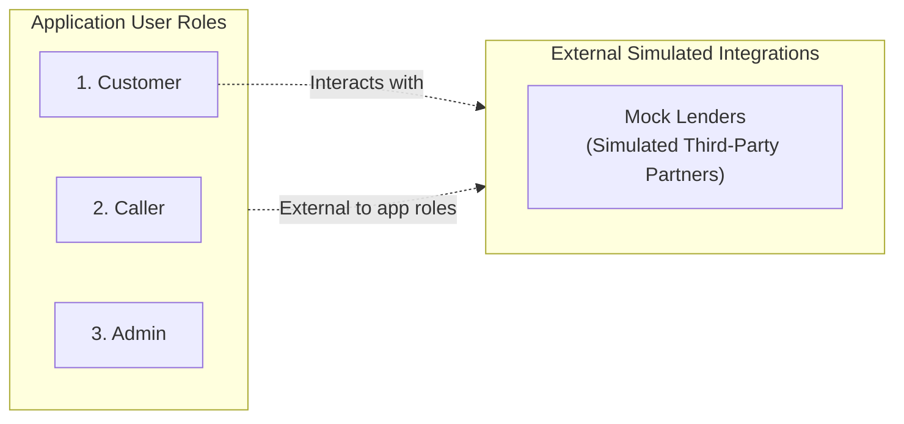
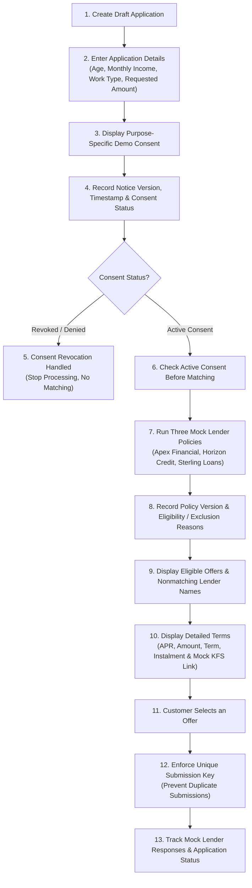
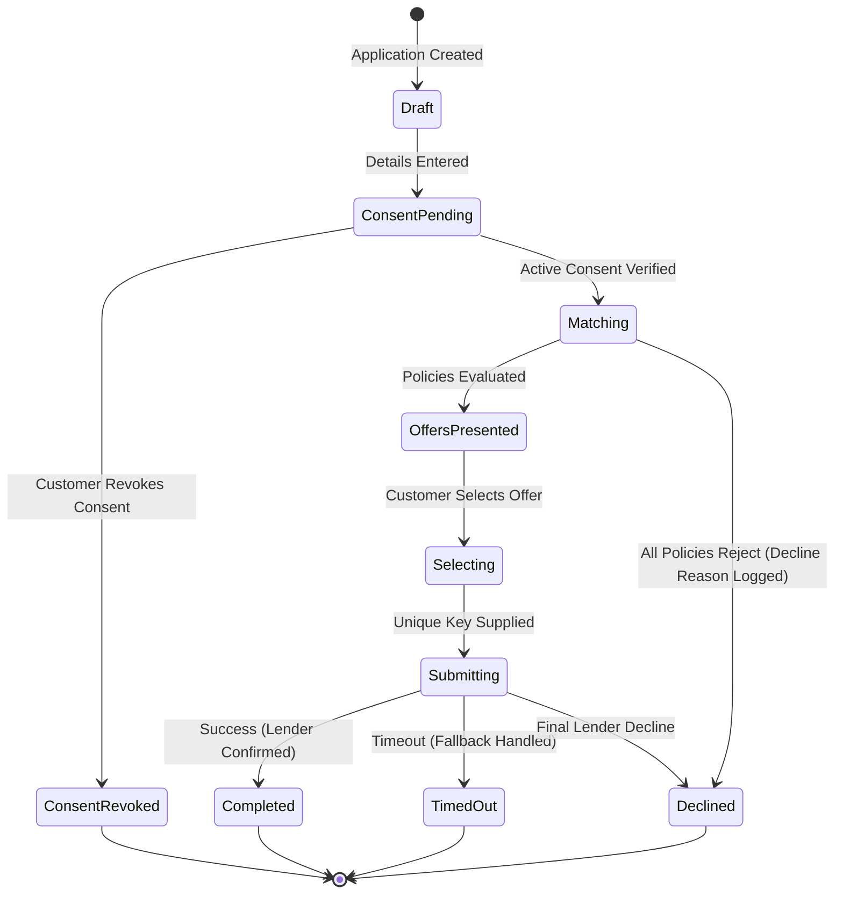

# Workflow & User Roles

This document defines the application user roles, customer journey, failure scenarios, and application lifecycle for the **Mini Loan Marketplace** in alignment with the Module 16 capstone requirements.

---

## 1. User Roles & Access Boundaries

The application strictly defines **three** application user roles:

### 1.1. Customer
- Creates a fictional loan application.
- Gives or revokes purpose-specific demo consent.
- Views eligible and nonmatching lender results.
- Compares offers (APR, amount, term, instalment, and mock KFS link).
- Selects an offer.
- Tracks application status.

### 1.2. Caller
- Can view only mock leads assigned directly to them.
- **Strict Isolation**: Cannot access other callers' leads.
- **Role Boundary**: Cannot access admin functionality or system configuration.

### 1.3. Admin
- Views aggregate application funnel metrics.
- Monitors application processing delays.
- Inspects system error events and failure trends.
- **Privacy Protection**: Must **not** receive sensitive customer records (PII) in dashboard responses; queries return anonymized, aggregated telemetry only.

> [!IMPORTANT]
> **External Simulated Integrations**:
> Mock lenders (*Apex Financial*, *Horizon Credit*, *Sterling Loans*) are **external simulated integrations**, not application user roles. They interact with the system via simulated adapters and webhooks, completely outside application authentication and authorization boundaries.

---

## 2. Customer Workflow Sequence

The customer journey follows a deterministic, 13-step sequence:

### Detailed Sequence Steps:

1. **Create Draft Application**: Customer initiates an application; system generates a draft record with a unique identifier.
2. **Enter Profile Details**: Customer inputs demographic and financial attributes:
   - **Age**
   - **Monthly Income**
   - **Work Type** (e.g., Salaried, Self-Employed)
   - **Requested Loan Amount**
3. **Display Purpose-Specific Demo Consent**: Presentation of clear, purpose-specific consent notices explicitly stating the scope of data use for mock loan matching.
4. **Record Consent Audit Trail**: The backend records:
   - `notice_version`: Exact version of the consent notice displayed.
   - `timestamp`: UTC ISO 8601 timestamp when consent was granted/modified.
   - `consent_status`: Explicit state (`GRANTED`, `REVOKED`, `PENDING`).
5. **Allow Consent Revocation**: The customer can revoke previously granted demo consent at any point prior to final submission.
6. **Check Active Consent**: The backend strictly validates that active, non-revoked consent exists before invoking the matching engine. If consent is absent or revoked, matching is blocked.
7. **Run Three Mock Lender Policies**: The matching engine evaluates the applicant profile across three fictional lender policies:
   - *Apex Financial Policy* (e.g., Prime risk rules: higher income & age requirements)
   - *Horizon Credit Policy* (e.g., Mid-tier risk rules: flexible employment options)
   - *Sterling Loans Policy* (e.g., Accessible credit rules: broad eligibility bounds)
8. **Record Policy Versions & Audit Reasons**: The system persists:
   - Exact policy version executed per lender.
   - Explicit eligibility decisions or exclusion reasons (e.g., `MIN_INCOME_NOT_MET`, `AGE_OUT_OF_BOUNDS`, `MAX_AMOUNT_EXCEEDED`).
9. **Display Eligible Offers & Nonmatching Lenders**: The customer receives transparent results displaying:
   - Full offer cards for matching lenders.
   - Transparent list of nonmatching lender names with high-level exclusion categories.
10. **Display Key Financial Terms**: For every eligible offer, the UI displays:
    - **APR** (Annual Percentage Rate)
    - **Approved Loan Amount**
    - **Tenure / Term** (months)
    - **Monthly Instalment** (EMI)
    - **Mock KFS Link** (Key Fact Statement document link for regulatory transparency simulation)
11. **Select an Offer**: The customer selects their preferred loan product.
12. **Prevent Duplicate Submissions**: A client-generated or backend-issued **unique submission key** (idempotency key) is required to submit the application. Resubmissions with the same key return the existing submission without creating duplicates.
13. **Track Responses & Lifecycle**: The backend logs mock lender responses, webhook receipts, and maintains application state progression through final completion.

---

## 3. Failure Scenarios & Safe Backend Handling

The backend architecture must handle failure scenarios safely, preserving data integrity, idempotency, and state consistency:

### 3.1. Success
- **Behavior**: Mock lender returns acceptance with final approved terms.
- **Handling**: Backend transitions application status to `COMPLETED`, records partner confirmation ID, and returns confirmation details to the customer.

### 3.2. Decline
- **Behavior**: One or more mock lenders reject the application due to policy criteria or credit simulation thresholds.
- **Handling**: System records the rejection event along with structured policy rejection codes. If all lenders decline, the application moves to `DECLINED` without breaking the workflow, offering transparent feedback.

### 3.3. Timeout
- **Behavior**: Simulated partner adapter fails to respond within the configured timeout window (e.g., 2000 ms).
- **Handling**: The backend safely aborts the pending request, flags the partner response as `TIMEOUT`, records a timeout telemetry event for the admin dashboard, and proceeds with responses from available lenders.

### 3.4. Duplicate Webhook
- **Behavior**: Network retries or simulated webhook emitters trigger multiple identical status callbacks.
- **Handling**: The backend enforces **idempotency** using the submission key and webhook event ID. If a webhook with an existing event ID has already been processed, the backend logs the duplicate, ignores redundant side effects, and returns `HTTP 200 OK`.

### 3.5. Late Webhook
- **Behavior**: A webhook arrives after the application has already transitioned into a terminal or timeout state (e.g., `TIMED_OUT`, `EXPIRED`, `CANCELLED`).
- **Handling**: The backend safely accepts the payload for auditing purposes, logs a `LATE_WEBHOOK_RECEIVED` event, but **refuses to mutate** the terminal application state.

### 3.6. Out-of-Order Status Event
- **Behavior**: Asynchronous delivery results in a status event arriving out of sequence (e.g., `DISBURSED` received before `OFFER_ACCEPTED`, or `FINAL_CONFIRMATION` arriving before `IN_REVIEW`).
- **Handling**: The backend implements a **monotonic state machine** with version checking or transition matrix validation. If an incoming event violates permissible state transitions, the event is queued or logged as an out-of-order exception, preventing invalid state regressions.

---

## 4. Application State Transitions Summary

| Current State | Permissible Next States | Trigger / Condition |
|---|---|---|
| `DRAFT` | `CONSENT_PENDING` | Profile data entered |
| `CONSENT_PENDING` | `MATCHING`, `CONSENT_REVOKED` | Consent granted or revoked |
| `CONSENT_REVOKED` | `CONSENT_PENDING` | Consent re-granted |
| `MATCHING` | `OFFERS_PRESENTED`, `DECLINED` | Mock policies evaluated |
| `OFFERS_PRESENTED` | `SELECTING`, `EXPIRED` | Customer views / timer lapses |
| `SELECTING` | `SUBMITTING` | Customer chooses offer + submission key |
| `SUBMITTING` | `COMPLETED`, `DECLINED`, `TIMED_OUT` | Mock partner webhook or timeout |
| `COMPLETED` | *(Terminal)* | Final success state |
| `DECLINED` | *(Terminal)* | All lenders declined |
| `TIMED_OUT` | *(Terminal)* | Partner timeout threshold exceeded |
