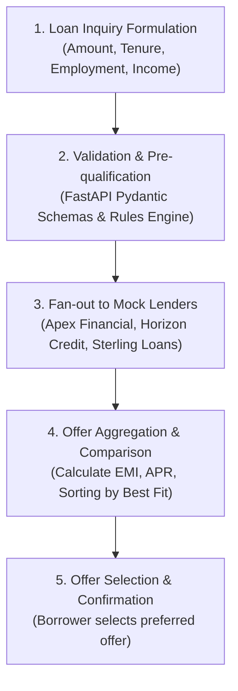
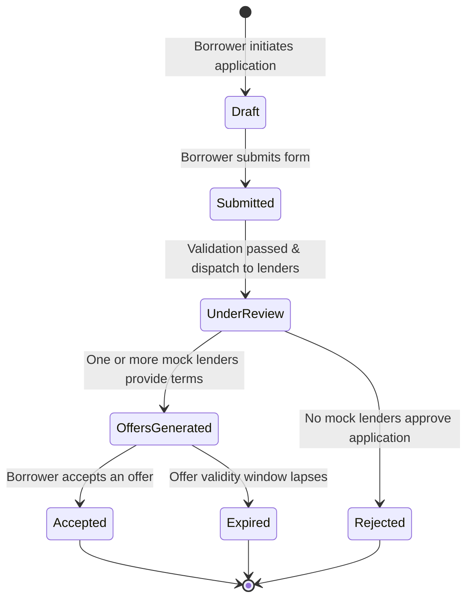

# Workflow & User Roles

This document defines the user personas, permissions, end-to-end customer journey, and internal application lifecycle within the **Mini Loan Marketplace**.

---

## 1. User Roles & Personas

| Role | Description | Primary Permissions & Responsibilities |
|---|---|---|
| **Borrower (Applicant)** | A consumer exploring personal/business loan options. | - Submit loan requests with requested amount, tenure, and employment details. - View aggregated and personalized loan offers. - Compare EMI, interest rates, and loan terms. - Select and accept an offer. |
| **Marketplace Administrator** | Platform operator monitoring the marketplace health. | - View all loan applications and status history. - Inspect mock lender response rates and average APRs. - Configure mock partner rules and latency settings. |
| **Mock Lender Partner** | Simulated financial institution (e.g., *Apex Financial*, *Horizon Credit*, *Sterling Loans*). | - Receives sanitized borrower profiles. - Returns custom loan terms (interest rate, maximum approved amount, fees). |

> [!NOTE]
> All applicant personas, lender entities, credit ratings, and transactions within this project are entirely fictional and used strictly for development and training.

---

## 2. Customer Application Workflow

The end-to-end customer workflow follows a structured 5-stage progression:

### Detailed Steps:

1. **Inquiry Formulation**:
   - The applicant specifies loan requirements (e.g., $10,000 for 36 months) along with fictional personal and financial profile parameters.
2. **Validation & Pre-qualification**:
   - The backend validates data types, acceptable bounds (e.g., min/max principal, positive tenure), and verifies basic eligibility thresholds.
3. **Mock Lender Evaluation**:
   - The system queries configured mock lenders with the sanitized application parameters.
   - Each mock lender executes internal fictional underwriting rules based on debt-to-income and employment stability.
4. **Offer Aggregation & Display**:
   - Active offers are returned with interest rates, calculated monthly installments (EMI), processing fees, and validity windows.
   - The frontend renders an interactive comparison table highlighting the best rate and lowest EMI.
5. **Offer Selection**:
   - The borrower accepts their chosen offer, transitioning the application to the final accepted state.

---

## 3. Application State Lifecycle

The loan application progresses through deterministic states managed by the backend service layer:

### State Descriptions:
- **Draft**: Application started on the client, form incomplete or unsaved.
- **Submitted**: Application received by the API and validated against schema requirements.
- **UnderReview**: Loan evaluation in progress across mock lender integrations.
- **OffersGenerated**: One or more approved loan terms returned for applicant comparison.
- **Accepted**: Borrower has committed to a specific lender's terms.
- **Rejected**: Application failed to meet mock underwriting criteria across all partners.
- **Expired**: Borrower took no action within the offer validity period.

---

## 4. Mock Lender Evaluation Logic (Fictional Simulation)

To provide realistic marketplace behavior without external dependencies, mock lenders implement distinct risk appetites:

- **Apex Financial**: Conservative partner. Requires higher fictional credit score/income; offers lowest interest rates (e.g., 6.5% - 8.5%).
- **Horizon Credit**: Balanced partner. Flexible tenure options; moderate interest rates (e.g., 8.5% - 11.5%).
- **Sterling Loans**: High-approval partner. Broader acceptance criteria for varied employment profiles; interest rates (e.g., 11.5% - 14.5%).
